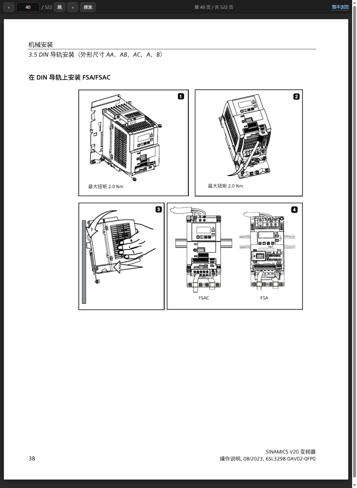
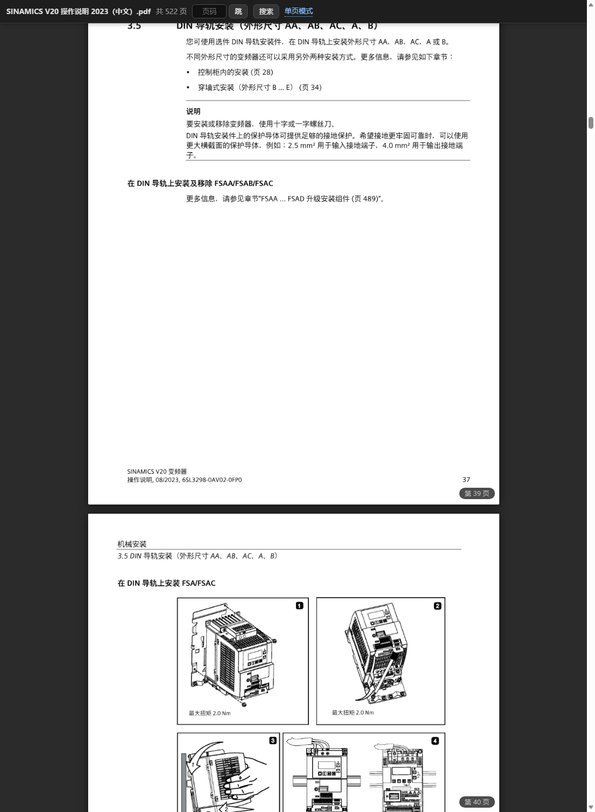
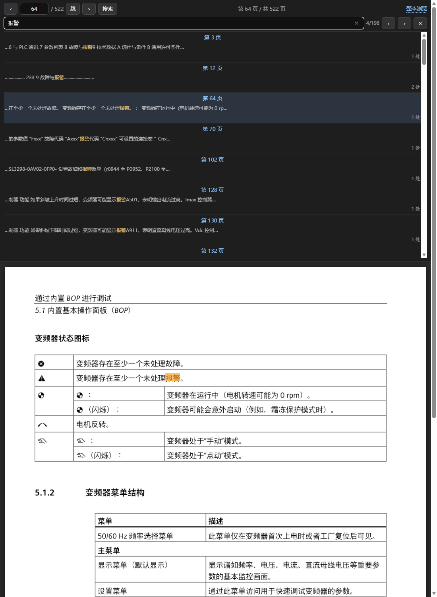

# dsh-pdf-jump

[中文](README.md) | **English**

Read local PDFs **inside the DSH sidebar**. One install ships two independent tools:

- **`pdf-view` (default)** — renders pages locally for **jumping to a page number**, **whole-document browsing**, **Ctrl+F full-text search**, **text selection/copy** and **Ctrl+wheel zoom**. The whole-document view fills the list with thumbnails first, swaps each page to full size when it scrolls into view, and has a page box at the top. Works anywhere, even without the native preview.
- **`pdf-open`** — opens the PDF with **DSH's native PDF preview** (client-side rendering, no image generation, no local server, selectable text). Used when you explicitly ask for the native preview, the fastest path, or no images. It calls `sidebar_open` itself; when the current session has no `sidebar_open` (the third-party sidebar plugin that provides it is not installed, or its "model opens the sidebar" switch is off), it falls back to the `pdf-view` renderer and returns a clickable link (`opened=false`).

Page numbers follow **PDF page order** (1 = first page of the file). The plugin deliberately does not infer the number printed in a footer: manuals often mix whole-book numbering with `chapter-page` numbering.



Jump by page number: type it in the toolbar; arrow keys flip pages.



Whole-document view: thumbnails first, full size as each page scrolls into view, with a page box at the top.

## Full-text search

The pages are rendered images, so the browser's own Ctrl+F cannot see any text in them. The viewer has its own search: **Ctrl+F** (or the **Search** button in the toolbar) opens a search bar, typing searches the whole document, hits are grouped by page with a short context line, `Enter` / `Shift+Enter` jump to the next / previous hit, and every hit is highlighted right on the page. The whole-document view has the same search bar.



Matching ignores whitespace and letter case. PDF text is delivered in small fragments (a Chinese manual often splits a sentence into several pieces), so a literal search for a phrase that spans fragments would otherwise miss. The first search builds a whole-document text index (3–8 seconds for a few hundred pages, with a "building index n/N" status); the index is cached on disk, so later searches on the same file take tens of milliseconds. Scanned PDFs have no text layer and cannot be searched.

Append `?q=` to a viewer URL to search on open: `/v/<id>/12?q=alarm`.

## Selecting and copying text

Pages are rendered as images, but the viewer lays a transparent text layer over each page: drag over the text and a **Copy** button appears next to the selection; click it, press **Ctrl+C**, or right-click the page and pick from the in-page menu (Copy / Copy page text / Select all). `Ctrl+A` selects the text of the current page (in the whole-document view, the pages already loaded). The selection follows the printed text; it is recalculated when the window or sidebar is resized.

The text layer only serves selection: page rendering and sharpness are unchanged. Scanned pages have no text layer and cannot be selected. The whole-document view supports the same selection, and dragging does not navigate away.

## Zoom (Ctrl+wheel)

- Hold **Ctrl** and scroll the wheel to zoom (trackpad pinch works too), anchored at the pointer; the toolbar **− 100% +** works as well.
- Shortcuts: `Ctrl+=` zoom in, `Ctrl+-` zoom out, `Ctrl+0` back to 100% (fit width).
- 100% means fit-to-sidebar width; past that the page scrolls horizontally. Works in both the single-page and whole-document views, keeps the zoom across page turns, and search highlights and selected text scale with the page.

## Install

```sh
dsh plugin --profile web add dsh-pdf-jump
```

Before the package is on npm, install straight from GitHub:

```sh
dsh plugin --profile web add github:taoziliyouchong/dsh-pdf-jump
```

Then restart DSH. Replace `web` with your profile name if you use another one.

After the restart a `/pdf` command is registered as well: `/pdf manual 300` returns the link without going through the model.

Requirements: DSH with the host `tools` and `systemPrompt` services (both are part of the normal base composition), Node 22.19+ or 24+.

Requires DSH >= 0.2.1-alpha.1 (lower bound inferred from the services and slots the plugin uses, all present in alpha.1); verified on 0.2.1-alpha.3 and 0.2.2-rc.1, later versions untested.

## Use

| You want | Tool |
| --- | --- |
| Open a PDF, jump to page N, browse the whole document | `pdf-view` (default; `page` = PDF page number) |
| Native preview (no images, selectable text) | `pdf-open` |
| Jump to a page inside the whole-document view | Page box at the top, or a `#p40` URL |
| Find a word in a manual | Ctrl+F in the viewer (single page and whole-document view) |
| Copy text from a page | Drag over the text, click the floating **Copy** button, or use Ctrl+C / the right-click menu |
| Zoom the page | Ctrl+wheel, Ctrl+= / Ctrl+- / Ctrl+0, or the toolbar **− 100% +** |
| Skip model judgement and open directly | `/pdf <file or fragment> [page]` |
| Extract text / metadata | install the `dsh-pdf` plugin and use its `pdf_info` / `pdf_extract_text` |

Both tools accept an absolute/relative path or a file-name fragment; relative paths resolve against the session working directory. Results are one clickable document line: `pdf-open` calls `sidebar_open` for the native preview (or falls back to the viewer link), `pdf-view` points at the local viewer page.

## How it works

- `pdf-open` resolves the path and calls `sidebar_open` (when the session has it) for the native preview; without `sidebar_open` it falls back to a `pdf-view` viewer link.
- `pdf-view` runs a local HTTP server bound to `127.0.0.1`; it tries ports 8731–8750, reuses a server already started by another DSH process, and starts as soon as the plugin loads. It stays up for the whole DSH session (`idleMinutes: 0`), so links from earlier conversations keep working.
- `pdf-view` renders pages with `pdfjs-dist` and `@napi-rs/canvas` into PNGs cached in the OS temp directory. A call warms the requested page ±2; opening a page warms ±`prefetchWindow` around it, outward one step at a time. Cached pages are served directly without entering the render queue. Page images and thumbnails carry a 1-hour browser cache, so flipping back and forth does not re-download them.
- Rendering runs in a **persistent child process** (`lib/render-worker.mjs`): each PDF is parsed once and a page takes 0.15–0.3 s. If another plugin in the same host ships a different pdf.js version, the later one rewrites `globalThis.pdfjsWorker` and mixing both in one process fails with "API version … does not match Worker version …"; the child has its own module graph and globals, so they cannot interfere. The child renders pages serially, and the queue is ordered "page the user wants → page in the whole-document view → thumbnail → prefetch". Concurrent requests for the same page are merged into one render, and pending prefetch work is dropped when the user turns the page, so fast flipping does not slow down. The process is replaced after 10 idle minutes or when it exceeds 1.2 GB resident memory; the next request restarts it.
- Full-text search: the first search extracts the text of every page in a one-shot child process (`lib/text-child.mjs`) and caches the index; the host scans that index and streams hits page by page (NDJSON). Highlights come from the current page's text layout (`/x/<id>/<page>?q=`) and are positioned as percentages of the page size, independent of the render scale. The same layout feeds the transparent text layer (`/l/<id>/<page>`) used for selection and copying.
- Whole-document view fills the list with 0.8× JPEG thumbnails first (tens of milliseconds per page) and swaps each page to a 1.5× PNG as it scrolls into view (about a third of the 2× byte size). Every page carries an anchor (`#p40`); the page box at the top scrolls to the requested page.
- The `/pdf` command always goes through `pdf-view` (single-page mode), starting at page 1 when no page is given; call `pdf-open` directly (or ask for the native preview) when you want the native viewer.
- Viewer URLs are short paths (`/v/<id>/<page>`, `/d/<id>`, `/p/<id>/<page>.png`, `/h/<id>/<page>.png`, `/t/<id>/<page>.jpg`) with no query string; the id maps to the file through a small registry in the temp directory. `/x/<id>/<page>?q=`, `/l/<id>/<page>` and `/search/<id>?q=` are API endpoints, not navigation URLs. Combined with the eager start on the same port, a link from an earlier conversation opens again after DSH restarts.
- Nothing is uploaded.

## Configuration

Optional, in the profile patch row (affects `pdf-view` only):


| Field | Default | Meaning |
| --- | --- | --- |
| `port` | `8731` | First port to try; the server scans upward for a free or already-running instance |
| `scale` | `2` | Render scale for the single-page viewer; 2 is roughly 144 dpi |
| `docScale` | `1.5` | Render scale for pages in the whole-document view |
| `idleMinutes` | `0` | Shut the server down after this many idle minutes; `0` keeps it running for the DSH session |
| `prefetch` | `true` | Warm pages around the current one in the background |
| `prefetchWindow` | `3` | How many pages on each side of the current page to warm |
| `roots` | `[]` | Extra search roots for file-name fragments |

`PDF_JUMP_ROOTS` (environment variable) adds search roots as well, separated by the platform path delimiter (`;` on Windows, `:` elsewhere).

## Limitations

- `pdf-open`'s native preview needs a sidebar plugin that registers the `sidebar_open` tool; that feature is off by default and must be enabled in its settings ("model opens the sidebar"). Without it, `pdf-open` falls back to the `pdf-view` renderer; no third-party plugin is needed just to read PDFs.
- `pdf-view` pages are images, but the viewer lays a transparent text layer over each page for selection and copying; scanned pages have no text layer to select or find. Install the `dsh-pdf` plugin and use its `pdf_extract_text` when you need the text itself.
- Rendering needs the `@napi-rs/canvas` prebuilt binary, which covers Windows, macOS and Linux on x64/arm64.

## Troubleshooting

- **The sidebar shows a blank page or "blocked"** (for `pdf-view` URLs): the in-app Sidebar Browser blocks loopback addresses unless they are allowlisted. Add `127.0.0.1:8731` (and whichever port in 8732–8750 is in use), or set *Settings → General → Open chat links in* to the default browser.
- **A link from an older conversation says "connection refused"**: either the viewer port changed (another program holds 8731) or the PDF file moved. Call the tool again for a fresh link; `pdf-open` paths are unaffected.

## Feedback

- Open an issue: https://github.com/taoziliyouchong/dsh-pdf-jump/issues — searchable, and others can help.
- Or reach me on QQ: **2171960697** (mention which plugin you installed when adding the contact).

Please include: DSH version, plugin version, the exact error text, and a screenshot.

## License

MIT
