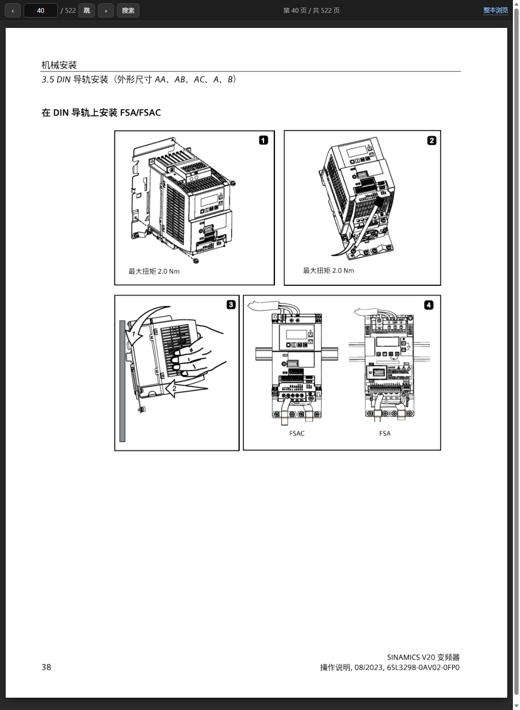
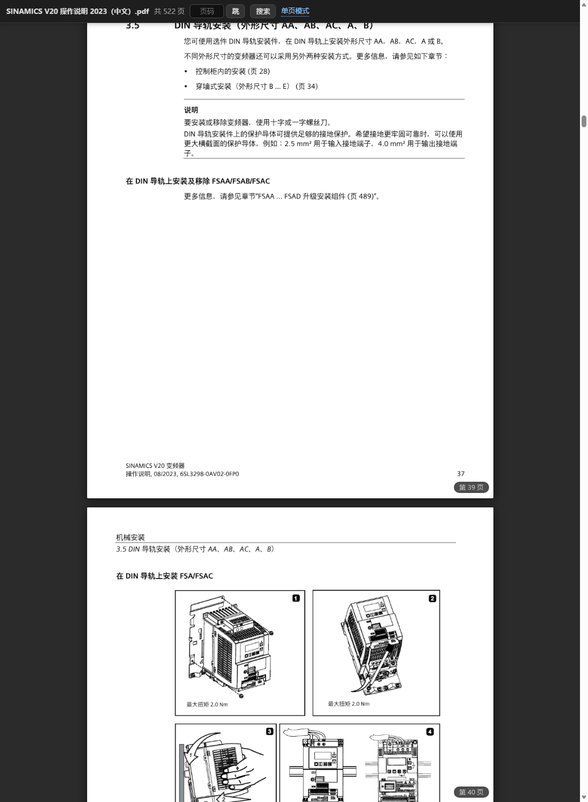
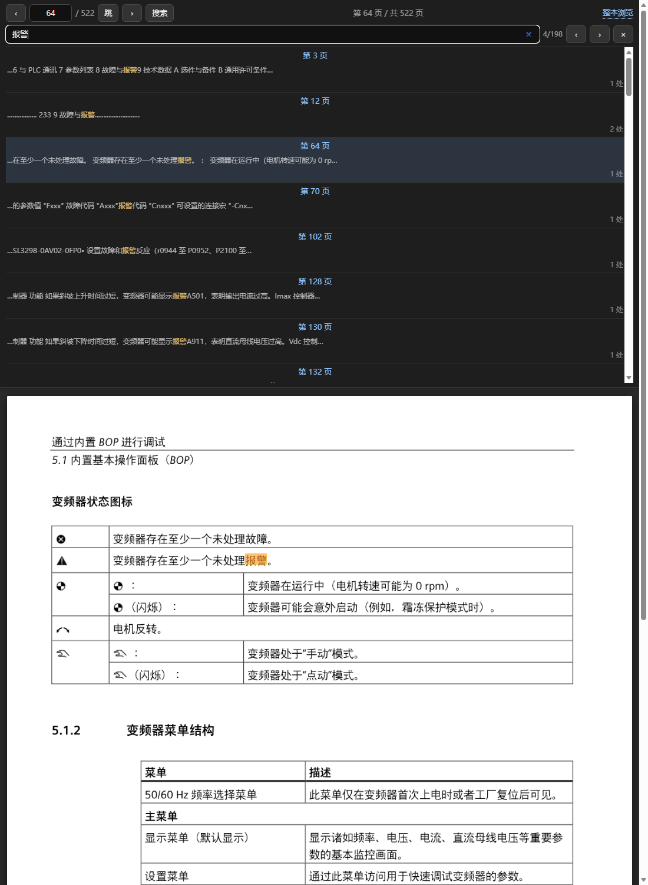

# dsh-pdf-jump

**中文** | [English](README.en.md)

在 DSH 侧栏里看本地 PDF。一个包装两个独立工具，装一次两个都可用：

- **`pdf-view`（默认入口）**：本地把页面渲染成图——**按页码跳**、**整本浏览**、**Ctrl+F 全文搜索**；整本页先出缩略图、滚到哪页换高清，页顶还能输入页码直接跳。不依赖原生预览，任何 profile 都能用。
- **`pdf-open`**：用 DSH **原生的 PDF 预览**打开（客户端直接渲染，不生成图片、不起本地服务、有文字层）；只在明确要「原生预览、不生成图片、最快」时用。它会自己调 `sidebar_open`；本会话没有 `sidebar_open`（提供它的第三方侧栏插件未装，或它的「模型打开侧栏」开关没开）时，自动回落到 `pdf-view` 的渲染查看器，返回可点的链接（`opened=false`）。

页码按 **PDF 页序**（1 = 文件第一页）。不从页脚推断印刷页码：手册常把全书页码和「章-页」编号混着用，猜出来的差值会把正文页整体错位。



按页码跳页：工具条里输入页码直接跳到那一页，方向键翻页。



整本浏览：缩略图先铺满，滚到哪页换高清；顶部也有页码框，输入即跳。

## 全文搜索

页面是渲染出来的图片，浏览器自带的 Ctrl+F 搜不到里面的字，所以查看器自己做了一套全文搜索：按 **Ctrl+F**（或点工具栏「搜索」）打开搜索条，输入就搜全书，命中按页列出来（页码 + 命中的上下文），`Enter` / `Shift+Enter` 跳下一处 / 上一处，命中处直接在页面上画高亮框。整本浏览页同样能用。



搜索忽略空格、不区分大小写——中文手册的正文常被 PDF 拆成一段段片段，按字面搜跨片段的词（例如「变频器 操作说明」）会漏。首次搜索要建一次全书文字索引（几百页 3–8 秒，界面显示「建索引 n/N」），建完落盘；之后再搜同一本只要几十毫秒。扫描件没有文字层，搜不到。

链接带上 `?q=` 打开即自动开搜：`/v/<id>/12?q=报警`。

## 安装

```sh
dsh plugin --profile web add dsh-pdf-jump
```

还没发布到 npm 时，直接从 GitHub 装：

```sh
dsh plugin --profile web add github:taoziliyouchong/dsh-pdf-jump
```

然后重启 DSH。用别的 profile 就把 `web` 换成你的 profile 名。

装好后除了两个工具，还会注册一个 `/pdf` 命令：`/pdf 繁易手册 300` 直接出链接，不经过模型判断。

要求：DSH 带宿主 `tools` 与 `systemPrompt` 服务（普通基础组合都含），Node 22.19+ 或 24+。

要求 DSH >= 0.2.1-alpha.1。

## 用法

| 你说 | 用哪个工具 |
| --- | --- |
| 打开某本 PDF、跳到第 N 页、整本翻 | `pdf-view`（默认；page = PDF 页序） |
| 要原生预览（不生成图片、能选中文字） | `pdf-open` |
| 在整本里跳到某页 | 整本页顶部输入页码，或地址带 `#p40` |
| 在手册里找某个词 | 打开后按 Ctrl+F（单页与整本页都行） |
| 不让模型判断、直接开 | `/pdf <文件或片段> [页码]` |
| 提取文字 / 读元数据 | 另装 `dsh-pdf` 插件，用它的 `pdf_info` / `pdf_extract_text` |

两个工具都接受绝对/相对路径或文件名片段（如 `NB系列 安装手册`）；相对路径按会话工作目录解析。结果都会显示成一条可点的文档行，`pdf-open` 自己调 `sidebar_open` 用原生预览打开（没有它时回落到查看器链接），`pdf-view` 指向本地查看页。

## 机制

- `pdf-open` 解析路径后直接调 `sidebar_open`（若本会话有）用原生预览打开；没有 `sidebar_open` 时自动回落到 `pdf-view` 的查看器链接。
- `pdf-view` 的本地 HTTP 服务只绑 `127.0.0.1`，端口从 8731 往上试，复用别的 DSH 进程已起的服务；插件一加载就启动，整个 DSH 会话期间常驻（`idleMinutes: 0`），旧对话里的链接不用重新生成。
- `pdf-view` 用 `pdfjs-dist` + `@napi-rs/canvas` 把页面渲成 PNG 缓存在系统临时目录；工具一调用先暖请求页和前后各 2 页，打开后以当前页为中心向两边暖 `prefetchWindow` 页。已缓存的页直接读盘、不进渲染队列；页图与缩略图带 1 小时浏览器缓存，来回翻页不重复下载。
- 渲染在**常驻子进程**里做（`lib/render-worker.mjs`）：一本 PDF 只解析一次，单页 0.15–0.3 秒。同一宿主里若还有别的插件带不同版本的 pdf.js，后写的那份会把 `globalThis.pdfjsWorker` 换成自己的，同进程混合会报「API version … does not match Worker version …」；子进程有自己的 module graph 与全局，互不影响。进程串行画页，排队按「用户要的页 → 整本清晰页 → 缩略图 → 预渲染」取；同一页的并发请求合并成一次；用户翻页时还没开始的预渲染任务直接作废，所以连翻不会越翻越慢。空闲 10 分钟或常驻内存超 1.2 GB 就换掉，下次请求自动重启。
- 全书搜索：首次搜索起一个一次性子进程抽全书正文（`lib/text-child.mjs`）落成索引；搜索在宿主里扫索引，按页流式返回（NDJSON）。命中高亮取当前页的文字版面（`/x/<id>/<page>?q=`），坐标按页宽比例缩放，与渲染倍率无关。
- 整本浏览先用 0.8 倍 JPEG 缩略图铺满（每页几十毫秒），滚到哪页再把那页换成 1.5 倍清晰版 PNG（字节约为 2 倍版的三分之一）；每一页都有锚点（`#p40`），整本页顶部输入页码即滚到该页。
- `/pdf` 命令固定走 `pdf-view`（单页跳转模式），不带页码时从第 1 页起；要原生预览就直接调 `pdf-open`，或说「原生预览打开」。
- 查看地址是短路径（`/v/<id>/<页>`、`/d/<id>`、`/p/<id>/<页>.png`、`/h/<id>/<页>.png`、`/t/<id>/<页>.jpg`），不带查询串；id 通过系统临时目录里的小注册表映射到文件。搜索用的 `/x/<id>/<页>?q=`、`/search/<id>?q=` 是接口地址，不用于页面跳转。配合「插件加载即启动、端口固定」，DSH 重启后旧对话里的链接也能重新打开。
- 不上传任何内容。

## 配置

可选，写在 profile 的 patch 行里（只影响 `pdf-view`）；字段与默认值：


| 字段 | 默认 | 含义 |
| --- | --- | --- |
| `port` | `8731` | 起始端口；被占用或已有同款服务时自动向上找 |
| `scale` | `2` | 单页查看器的渲染倍率，2 约等于 144 dpi |
| `docScale` | `1.5` | 整本浏览清晰版的渲染倍率 |
| `idleMinutes` | `0` | 空闲多少分钟后关掉服务；`0` 表示整个 DSH 会话常驻 |
| `prefetch` | `true` | 是否在后台暖当前页附近的页面 |
| `prefetchWindow` | `3` | 当前页两侧各暖多少页 |
| `roots` | `[]` | 文件名片段搜索的额外根目录 |

环境变量 `PDF_JUMP_ROOTS` 也可以加搜索根，按平台的路径分隔符分隔（Windows 是 `;`，其他是 `:`）。

## 限制

- `pdf-open` 的原生预览依赖一个提供 `sidebar_open` 工具的侧栏插件（如 dsh-better-sidebar），且该功能默认关闭、需要在它的设置里打开「模型打开侧栏」。没有它时 `pdf-open` 自动回落到 `pdf-view` 的渲染查看器；只想看 PDF 的话不装任何第三方也能用。
- `pdf-view` 的页面是图片：不能选中复制；搜索走查看器自己的 Ctrl+F（见上），扫描件没有文字层时搜不到。要按页取文字另装 `dsh-pdf` 插件，用它的 `pdf_extract_text`。
- 渲染依赖 `@napi-rs/canvas` 的预编译二进制，覆盖 Windows / macOS / Linux 的 x64 与 arm64。

## 打不开时

- **侧栏空白或提示「已阻止」**：应用内侧栏浏览器默认拦截本机回环地址。把 `127.0.0.1:8731`（及 8732–8750 中实际用到的）加进侧栏设置的「允许访问的本机地址」，或把「设置 → 通用 → 网页链接默认打开方式」改成「默认浏览器」。
- **旧对话里的链接提示「拒绝连接」**：要么端口被别的程序占了导致换了端口，要么 PDF 文件被移动/删除。重新调用一次工具取新地址；`pdf-open` 返回的文件路径不受影响。

## 反馈

插件有问题，按这个顺序：

1. 开 Issue：https://github.com/taoziliyouchong/dsh-pdf-jump/issues —— 能留痕、能搜历史，别人也可能已经遇过；
2. 急着问或不想开 Issue，QQ 号：**2171960697**（加好友请注明装的是哪个插件）。

反馈时带上：DSH 版本、插件版本、报错原文、截图。少一样多半要再问一轮。

## 许可

MIT
